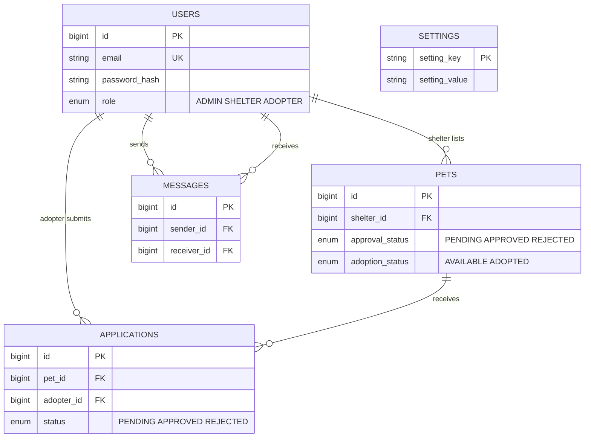
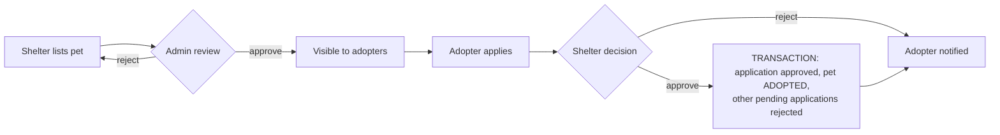

# Online Pet Adoption Platform (Java Servlets + JSP + JDBC)

A role-based web application where **shelters** list pets, **adopters** browse and apply, and **admins** run the platform.
Built with only Java web technologies: Servlets, JSP/JSTL, JDBC, MySQL, Maven. No Spring, no Hibernate, no JS framework.

## 1. Quick start

**Requirements:** JDK 11+, Maven 3.6+, MySQL 5.7+/8.x, Apache Tomcat **9.x** (Tomcat 10+ will not work: it uses `jakarta.*` instead of `javax.*`).

1. Create the database and seed data:
   ```bash
   mysql -u root -p < sql/schema.sql
   ```
2. Set your DB credentials in `src/main/resources/db.properties` (or use env vars `DB_URL`, `DB_USER`, `DB_PASSWORD`).
3. Build: `mvn clean package` → produces `target/petadoption.war`.
4. Deploy the WAR to Tomcat 9 (copy to `webapps/`, or in an IDE add it to a Tomcat 9 server), then open
   **http://localhost:8080/petadoption/**
   (Optional: `mvn package cargo:run` downloads Tomcat 9 and runs it for you.)

Uploaded pet photos are stored outside the WAR in `~/petadopt-uploads` (override with `upload.dir` / `UPLOAD_DIR`).

### Demo accounts
| Role | Email | Password |
|---|---|---|
| Admin | admin@petadopt.com | Admin@123 |
| Shelter | shelter@petadopt.com | Shelter@123 |
| Shelter | rescue@petadopt.com | Shelter@123 |
| Adopter | adopter@petadopt.com | Adopter@123 |

## 2. Features by role

**Admin**: user management (create / update / delete, change roles), approve or reject pet listings, system settings (site name, contact email, registration open/closed, max pending applications per adopter), platform analytics (users, pets, applications, adoption rate, pets by type, shelter ranking).

**Shelter**: list pets with photo upload, edit / delete / mark adopted, review applications (approve / reject with a note), message adopters, adoption statistics.

**Adopter**: search pets by type / breed / location, apply for adoption, track an application by its ID, edit profile and password, adoption history, message shelters.

Every action shows a confirmation or error message.

## 3. Architecture

```
com.petadopt
 ├── model      User (abstract) → Admin / Shelter / Adopter, Pet, Application, Message, enums
 ├── dao        interfaces + JDBC implementations (BaseDAO holds the shared PreparedStatement plumbing)
 ├── service    business rules: Auth, User, Pet, Adoption (transaction), Message, Analytics, Setting
 ├── servlet    controllers (BaseServlet adds CSRF check, flash messages, view forwarding)
 ├── filter     AuthFilter (logged in?) → RoleFilter (right role for /admin, /shelter, /adopter)
 ├── util       DBConnection, AppConfig, PasswordUtil, Validator, CsrfUtil, PhotoStorage
 └── exception  AppException → ValidationException, DuplicateEmailException, ResourceNotFoundException,
                AccessDeniedException, DataAccessException
webapp/WEB-INF/views   JSP views (JSTL only, no scriptlets) per role + shared header/footer
webapp/WEB-INF/tags    reusable tag files (csrf, status badge, pet thumbnail, pet card)
```
Request flow: `Browser → Filter(s) → Servlet → Service → DAO → MySQL`, then the servlet forwards to a JSP under `WEB-INF/views`
(views are never reachable directly). POST actions use Post-Redirect-Get.

## 4. Database (ER diagram)


`applications` has a UNIQUE(pet_id, adopter_id) key so an adopter cannot apply twice for the same pet.

### Adoption lifecycle


## 5. Where each rubric area is covered

| Rubric | What to look at |
|---|---|
| **Problem understanding & design (8)** | This README (ER diagram, lifecycle), layered package design, every input/output/functionality in the brief mapped to a servlet + view, per-role dashboards |
| **Core Java concepts (10)** | Abstract `User` + 3 subclasses (inheritance, polymorphism: `getDashboardPath()`), interfaces for every DAO, enums, generics + collections, streams/lambdas (`MessageService`, `AdoptionService.splitAdoptedAndOther`, `RoleFilter`), `Optional`, custom exception hierarchy with try/catch/finally, singletons (`DBConnection`, `AppConfig`, `SettingService`), fluent `Validator`, functional interface `RowMapper` |
| **JDBC (8)** | `PreparedStatement` everywhere (no SQL string concatenation of values), try-with-resources, `BaseDAO`, JOIN / GROUP BY / subquery analytics (`StatsDAOImpl`), **transaction with commit/rollback** in `AdoptionService.decide`, `SELECT … FOR UPDATE`, generated keys, unique-key handling, PBKDF2 password hashing |
| **Servlets & web (7)** | One servlet per concern, `doGet`/`doPost`, `HttpSession` login with session-fixation protection, ordered `AuthFilter` → `RoleFilter`, CSRF tokens, `@MultipartConfig` photo upload, Post-Redirect-Get with flash messages, JSTL views, custom 403/404/500 pages |

## 6. Security notes
- Passwords: salted PBKDF2-HMAC-SHA256 (65,536 iterations); constant-time comparison.
- All SQL values are bound parameters. All output is escaped with `<c:out>`.
- CSRF token required on every POST; session id rotated on login; HttpOnly session cookie; private pages sent with `no-store`.
- Role checks happen in a filter **and** in the services (e.g. a shelter can only decide its own applications).
- Uploads: type whitelist, 5 MB limit, random file names, path-traversal-safe serving.

## 7. Verification performed
Compiled with `javac --release 11 -Xlint:all` (no warnings); every JSP and tag file pre-compiled with Tomcat's Jasper; and a 40-check
end-to-end test run against Tomcat 9 and a MySQL-compatible database (MariaDB) covering login, RBAC, CSRF, validation, XSS escaping,
photo upload, apply / approve / auto-reject transaction, messaging, settings and logout.
Not run here: the Maven build itself (no access to Maven Central from the test sandbox) and the official MySQL Connector/J driver
(the test used the MariaDB driver through a test-only shim). `pom.xml` uses standard coordinates, so `mvn clean package` should just work.
